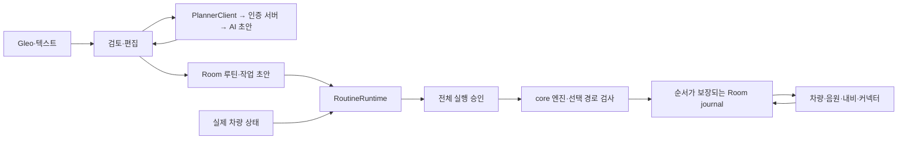
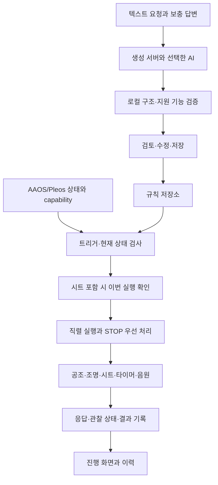

# AI 루틴 앱 기술 설계와 구현 계약

## 2026-11-02 A05 실행 설명과 이력

Room3은 실행 당시 규칙·revision·의미 해시와 nullable 시작 원인을 저장한다. 실제 실행은 단계 journal을 유지하고 가상 실행도 snapshot을 함께 보존한다.2→3은 startCause 추가,1→3은 기존 migration 연결이며 과거 누락 값은 null로 남긴다.

`RunHistory`는 당시 metadata가 일치하는 snapshot으로 표시·편집·설명 입력을 만든다. 현재 저장본과 다르면 복사본을 열고, 이미 수집한 화면 상태를 동기적으로 선택하여 오래된 DB 응답이 새 편집을 덮어쓰지 않게 한다. 복구 journal 로딩 완료 전에는 설명/조건 편집을 보류한다.

`POST /v1/run-explanations`는 `{requestId,locale,workflow,run,startCause,omittedEventCount}`를 받으며 최대128개 이벤트(앞32/뒤96)의 원래 순번과 생략 건수를 유지한다. 생성 API와 동일한 인증·예산·동시 요청 제한을 사용하고 설명 전용 strict 출력 `{runId,summary,details,limitations}`의 run/node/event 참조를 검증한다. 실행 자격이 없는 BLOCKED 기록도 설명할 수 있도록 입력 schema/참조와 실행 의미 검증을 분리한다. AI 텍스트는 참고 표시이며 원래 상태·승인·규칙을 갱신하지 않는다. [A05 증거](evidence/A05/verification-2026-11-02.md)

## 2026-10-30 코드에서 확인한 구조와 계약

| 실제 경로 | 책임·연결 |
|---|---|
| `android/core/src/main/kotlin/com/pleos/routine/core/` | Workflow 모델·검증·편집/패치·트리거·실행 엔진·순수 시뮬레이터. Android/네트워크 IO와 분리 |
| `android/app/src/main/java/com/pleos/routine/MainActivity.kt` | Compose 편집과 Gleo 진입. singleTask/onNewIntent는 현재 편집 상태를 유지하며 요청만 재평가 |
| `android/app/src/main/java/com/pleos/routine/data/` | Room2, 요청 보관, 실행 정의 snapshot과 순번 event journal, 서버 주소 정책 |
| `android/app/src/main/java/com/pleos/routine/execution/` | 서비스가 실행 수명 소유. 실행 전 전체 시트 승인, journal 영속화 후 진행, 취소·복구 연결 |
| `android/app/src/main/java/com/pleos/routine/vehicle/` | 공식 SDK typed 호출, 상태 시각·연결 세대, MOVE/STOP 조정. 실제 교정 전 seatPolicy=null |
| `server/src/` | strict DTO·그래프 검증, OpenAI 공식 원점, KST 비용 예약/영속 차단, 허용한 커넥터·HTTP 경계 |
| `contracts/`, `scripts/`, `evidence/` | 스키마·Gleo/연결 카탈로그, 재현 명령, UNIT/AVD 증거 |



시트 포함 실행은 어떤 부작용보다 먼저 이번 실행 전체의 확인을 받는다. 개별 MOVE 직전에는 상태·영역·교정 범위를 다시 검사하며 STOP은 독립 감시 경로를 갖는다. 늦은 STOP 응답·연결 세대 변경·관찰 실패는 journal을 지우지 않고 UNKNOWN으로 남긴다. 제품 잠금 해제에는 실제 AVD 두 축의 이동·정지 증거가 필요하다.

엔진은 선택된 ACTION만 preflight하므로 미선택 열선의 capability 실패가 독립 내비를 막지 않는다. 활성 정의를 동기화하여 비활성 중 이벤트를 재생하지 않고, 결합 조건 전체의 진입을 판단하며 cooldown은 실제 시작 때 소비한다. `elapsedRealtime` 기반의 경과 시간을 사용하고 WAIT/TIMER/전체 2시간 한도를 최대 1초 간격으로 재평가한다.

Room1→2는 기존 행을 보존한다. 실행 시작 시 동일 runId에 정의·revision·semanticHash를 저장하고, 각 단계는 순번·응답·관찰값을 영속화한 다음 진행한다. journal 실패는 병렬 형제의 후속 부작용도 차단한다. 프로세스 재시작은 RUNNING을 UNKNOWN으로 바꾸며 물리 명령을 재전송하지 않는다. 초안의 그래프·텍스트·원본 요청 ID는 한 트랜잭션에 저장한다.

서버 예산은 Asia/Seoul 일/월 기준이며 timestamp 없는 기존 UTC 행은 겹치는 기간에 보수적으로 산입한다. 비용 초과/잘못된 사용량은 예약·확인 비용을 보존하고 DB에 차단을 저장한다. HTTP 요청128KiB/응답256KiB, 인증·Origin 거부, 공급자 원점 고정과 외부 호출 기본 비활성은 서버에서 강제한다. 실제 검증은 [최신 장부](evidence/implementation/2026-10-29.md)를 따른다.

## 2026-10-27 구현 아키텍처

실제 구조는 `android/core`, `android/app`, `server`, `contracts`, `scripts`, `evidence`다. core는 Kotlin 직렬화 모델·검증·패치·의미 해시·엔진·순수 시뮬레이터를 갖는다. app은 Compose/Room/Vehicle SDK/NaviHelper/Media3 및 foreground 실행 서비스를 연결한다. Node24 서버는 OpenAI Responses strict 출력과 SQLite 비용 예약을 담당한다. 실행·권한·승인 권한은 앱에만 있다.

실행 형식은 [schemaVersion 2](contracts/workflow.schema.json)다. START/ACTION/IF/WAIT/TIMER/REPEAT/PARALLEL/JOIN/END와 명시적 port 연결을 사용한다. 64노드·4병렬·20반복·2시간·최악 경로4,096회 노드 방문을 제한한다. 시트·공조 등 겹칠 수 있는 영역은 보수적인 서브시스템 자원 잠금으로 충돌을 막는다. 편집 패치는 기준 revision을 확인한다. 제목·카드 위치 변경은 테스트 의미 해시를 바꾸지 않는다.

4,096회는 사용자 추가 확정 계약이다. 앱 core와 서버는 구조 검증을 통과한 그래프에서 반복 본문×횟수, 병렬 분기 합, IF 분기 최대를 계산한다. START/END 및 실제 방문한 제어 노드는1회로 센다. 반복 본문의 종단 JOIN은 방문하지 않으며 병렬의 JOIN은 합류 후1회 방문한다. 중첩 산술은4,097에서 포화시켜 overflow를 막는다. 초과 가능하면 검토 저장·시험 전에 거부하고 런타임 카운터도 유지한다. 작업 초안 자동 보관은 유효 루틴 저장과 구분한다.

실행 결과는 REQUESTED/ACKNOWLEDGED/VERIFIED/UNKNOWN 등을 구분하고 시뮬레이션에는 SIMULATED를 사용한다. 서비스가 실행을 소유하므로 화면 전환 자체는 취소 사유가 아니다. 안전 조건 상실·취소·시간 초과에서는 STOP을 우선하고 무조건 rollback하지 않는다. 재부팅은 활성 규칙의 새 이벤트만 감시한다. 실제 통합 검증 상태는 [증거 기록](evidence/implementation/2026-10-27.md)에 있다.

**이하 구조·JSON·활성 세션/7동작 제한은 초기 설계 이력이다. 현재 코드 계약은 위 스키마 v2와 core를 따른다.** 시트 확인·STOP·불명 결과 보존 등 안전 계약은 계속 유효하다.

기준: **2026-10-25 KST**. 아래 디렉터리·타입·API는 제품 내부의 제안 설계다. 실제 앱·서버 코드는 아직 없다. Pleos SDK의 정확한 함수·단위·권한은 [기능 표](05_CAPABILITY_MATRIX.md)를 따른다. 요구사항 ID는 [PRD](03_PRODUCT_PRD.md), 실행 순서는 [TODO](13_IMPLEMENTATION_TODO.md)가 기준이다.

## 현재 구조와 향후 구조

현재: 루트 Markdown 문서와 `references/`의 공식 양식·메모. Android 프로젝트·서버·빌드 설정·Git 이력은 없다.

아래는 후속 개발 시 생성할 제안 구조이며 지금 만들어진 파일이 아니다. 처음에는 Android 단일 app 모듈 안의 패키지로 책임을 나누고, 근거 없이 멀티모듈·범용 플러그인 프레임워크를 추가하지 않는다.

```text
android/                  # 향후 Gradle 프로젝트, Wrapper 포함
  app/src/main/.../
    composer/             # 입력, 초안·질문, 편집
    domain/               # 규칙·검증·트리거·실행 상태 (플랫폼 분리)
    data/                 # 로컬 규칙·이력 저장
    vehicle/              # AAOS/Pleos 상태·capability·제어
    execution/            # 직렬 실행, STOP, 타이머·음원
    ui/                   # 루틴·확인·실행·이력·연결 화면
  app/src/test/.../        # 가짜 시계·어댑터로 순수 로직 시험
  app/src/androidTest/.../# 저장·수명·UI 계측 시험
server/                   # 향후 생성 서버; 공급자·런타임 결정 후 생성
  contracts/              # API 및 JSON 스키마의 단일 정의
  tests/                  # 계약·오류·AI 평가
evidence/                # 향후 실제 증거; 파일명은 07·13의 규칙 준수
```

코드 경로는 소스 분석 후 확정하고 TODO에 기록한다. Kotlin·공식 샘플의 Compose 구성을 UI 출발 후보로 삼되 저장·네트워크·직렬화 라이브러리 및 서버 런타임은 사용자의 새 의존성 승인 규칙과 공식 호환성 검토를 거쳐 결정한다. 결정 전 임의 버전을 구현 필수값으로 쓰지 않는다. [공식 샘플](https://github.com/Pleos-Playground/pleos-sample-vehicle-app)

## 데이터 흐름과 책임



| 경계 | 입력 → 출력 | 책임과 제한 |
|---|---|---|
| PlannerClient/서버 | PlannerRequest → PlannerResponse | 생성만 수행. 차량 SDK·셸·임의 도구 호출 없음 |
| RoutineValidator | 초안+제품 정책+현재 지원 정보 → 검증 결과 | 타입·enum·값·영역·지원 여부 검증, 추가 필드/코드/URL 거부 |
| RoutineStore | 승인한 규칙 → 버전 있는 StoredRoutine | 편집 시 새 버전. AI가 id·enabled·실행 승인을 부여하지 않음 |
| VehicleStateAdapter | AAOS/Pleos 읽기 → VehicleSnapshot/변경 이벤트 | 값·단위·상태·관찰시각·데이터 출처 포함 |
| CapabilityRegistry | 연결+권한+API 조회 → 기능별 CapabilitySnapshot | 기능/영역/접근/범위 구분, 연결·권한 변경 시 무효화 |
| RuleEngine | 규칙+상태+시계+트리거 → Blocked 또는 실행 후보 | 외부 쓰기 없이 조건·중복·충돌 판단 |
| VehicleControlAdapter | 검증된 typed command → 응답/관찰 결과 | 공조·조명·시트별 정확한 SDK 호출, 매 호출 영역·범위 확인 |
| ActionExecutor | 승인된 실행 계획 → 동작별 결과 | 단일 루틴·단일 시트 축, STOP 우선, 지연 응답 처리 |
| ExecutionJournal | run/action 이벤트 → 로컬 이력 | 요청/응답/관찰/중단 원인, 버전·상관 ID 기록 |

위 명칭은 내부 설계이며 SDK에 같은 이름의 클래스가 있다고 가정하지 않는다. API 34 실행 환경에서 존재하는 AAOS API를 확인하고, 최신 문서에만 있는 구독 메서드를 버전 검사 없이 호출하지 않는다. [CarPropertyManager](https://developer.android.com/reference/android/car/hardware/property/CarPropertyManager)

## 생성 서버 계약

내부 제안 경로: `POST /v1/routine-drafts`. 서버는 공급자 SDK를 감추는 `RoutinePlanner.generate()` 경계를 가진다. 공급자·런타임·인증·호스팅·요금 한도는 별도 결정 작업이며 아직 미정이다.

- 요청: `requestId`, `locale`, `requestText`, `capabilitySummary`, 선택적인 이전 초안·보충 답변. 차량 VIN·정확한 위치·속도 이력·오디오 원본은 전송하지 않는다.
- 응답: `schemaVersion`, `status`, `draft`, `questions`, `unsupportedRequests`. `status`는 `draft`, `needs_clarification`, `unsupported`만 허용한다.
- `draft`: 생성할 제목·트리거·시간 조건·typed actions. `needs_clarification`에서는 질문에 답하기 전 저장 불가. `unsupported`에서는 실행 가능한 전체 초안으로 표시하지 않는다.
- 혼합 요청: 가능한 초안과 지원 불가 항목을 함께 표시한다. 일부만 저장하는 경우 사용자가 명시적으로 선택한 새 규칙으로 저장하고 원문과 빠진 항목을 보존한다.
- 모델 거부·JSON 오류·타임아웃·요금 한도·인증 실패는 공급자별 오류를 앱의 오류 코드로 매핑한다. 자동 재시도 때문에 중복 초안이나 무제한 비용이 생기지 않도록 상한을 결정·시험한다. 생성 요청 재시도는 차량 실행 재시도와 분리한다.
- 실 API 경로와 테스트 fixture를 UI·로그에서 구분한다. 네트워크 실패 때 템플릿을 AI 생성 성공으로 보여주지 않는다. 저장된 규칙 실행은 네트워크에 의존하지 않는다.

HTTP 인증·요청 크기/시간·동시성·보존기간·비용 상한은 공급자 선정 기록에 수치와 공식 근거를 남긴 후 서버 구현을 연다. 외부에 인증 없는 생성 서버를 공개하는 것을 기본값으로 삼지 않는다. 키는 서버에서만 관리한다.

## 내부 루틴 모델

다음은 생성 응답 안의 `draft` 예시다. 모든 숫자·색·영역은 희망값 예시이며 capability 검증 전 실행 가능한 값이 아니다. 실제 승인·실행 권한 필드는 모델 출력에 포함하지 않는다.

```json
{
  "title": "점심 휴식",
  "trigger": {"type": "MANUAL"},
  "conditions": {
    "timeWindow": {"from": "13:00", "to": "15:00", "zone": "Asia/Seoul"},
    "requireParkedAndStationary": true
  },
  "actions": [
    {"type": "SET_HVAC_TARGET", "area": "DRIVER", "celsius": 23.0},
    {"type": "SET_AMBIENT_BRIGHTNESS", "area": "DRIVER", "requestedPercent": 20},
    {"type": "SET_AMBIENT_COLOR", "area": "DRIVER", "argbHex": "#FF0000FF"},
    {"type": "MOVE_SEAT_LIMITED", "area": "DRIVER", "axis": "FORE_AFT", "direction": "BACKWARD"},
    {"type": "MOVE_SEAT_LIMITED", "area": "DRIVER", "axis": "BACKREST", "direction": "BACKWARD"},
    {"type": "PLAY_LOCAL_AUDIO", "assetId": "licensed-rest-01"},
    {"type": "START_TIMER", "durationSeconds": 1800}
  ]
}
```

`DRIVER`는 운전석을 뜻하는 제품 내부 라벨이며 SDK의 고정 숫자가 아니다. 대상 AVD의 좌석 정의·지원 영역을 확인해서 매핑한다.

제품 검증기 규칙:

- 시간 구간은 같은 날짜의 `[from,to)`와 명시적 시간대. 자정 횡단·중첩 OR·임의 스크립트는 첫 버전에서 거부하고 설명한다.
- 위 7개 동작이 한 루틴에 들어갈 수 있도록 **최대 7개**로 둔다. 같은 기능·영역 또는 같은 시트 축의 중복 동작은 저장 전 해결한다. 기존 최대 5개 제안은 폐기한다.
- 타이머 60~3600초, 음원은 앱의 허가된 assetId만. 공조·밝기·좌석 범위는 차량 capability에서 얻는다.
- 밝기의 percent는 제품 요청값이다. SDK 원시값을 항상 0~100으로 간주하지 않는다. 대상 AVD에서 단위·스케일을 검증한 변환만 허용하며 미확정이면 저장/실행을 차단한다.
- 색상은 불투명 ARGB 32비트로 변환한다. 지원 색 범위와 반영값을 확인한다. 임의 문자열·URL·float를 색상 SDK 값으로 넘기지 않는다.
- 시트는 축·방향만 초안에 담는다. 이동시간·속도·목표각도·거리·승인 토큰을 AI가 지정할 수 없다. 검증된 앱 실행 정책을 적용한다.
- `requireParkedAndStationary=false`는 실행 허용으로 해석하지 않는다. 사용자에게 제품 제한을 설명하고 새 초안을 확인받는다.

저장 시 앱이 `schemaVersion=1`, `routineId`, `version`, `enabled=false`, `scope=ACTIVE_APP_SESSION`과 원문/승인 기록을 부여한다. 앱 시작마다 실행 세션은 비활성으로 복구하고 사용자가 다시 활성화한다. 저장된 시트 동의는 다음 실행의 동의로 재사용하지 않는다.

## 상태·지원 정보와 미확정 정책값

VehicleSnapshot은 gear/speed의 `value`, `unit`, SDK 상태, 수신 단조시각, 원본 시각(있으면), 연결 세대, 입력 출처를 가진다. property 목록에서 사라졌다는 이유만으로 미지원이라고 단정하지 않는다. 권한 부족·일시 불가·UNKNOWN·ERROR를 구분한다.

초기 시험 후보는 P단과 `abs(speed)<0.1m/s`, 속도 freshness 2초다. 이는 기존 제품 가설이지 공식 보장이나 안전 인증 수치가 아니다. 상태 이벤트 주기와 정차 노이즈를 계측하고 아래 정책표를 확정하기 전 차량 쓰기 게이트를 열지 않는다. 기어 ONCHANGE의 오랜 무변화를 오류로만 판단하지 말고 실행 직전 snapshot 재조회로 유효성을 확인한다.

| 미확정 정책 | 결정에 필요한 증거 | 확정 전 처리 |
|---|---|---|
| 속도 임계·freshness | 실제 AAOS 주기·시각·정차/움직임 값 | 쓰기 실행 차단 |
| 시트 축별 제한 이동시간 | 한 축 최소 이동·위치 관찰·STOP 응답/정지 관찰 시간 | 제품 이동 비활성 |
| 상태 반영·STOP 확인 timeout | 응답 지연과 위치 안정화 관찰, 반복 시험 | 성공 추정 금지 |
| 시트 경계·방향 매핑 | 영역별 bounds와 방향 이동 후 위치 변화 | 방향/단위 추정 금지 |
| 승인 대기 만료·재검사 시점 | UX 과제, 대기 중 상태/규칙 변경 | 확인 시 전 조건 재검사 |

최초 측정은 [검증 계획](07_VALIDATION_AND_DEMO.md)의 W05 에뮬레이터 전용 스파이크 절차로 수행한다. 제품 한도 확정 전에는 제품 자동 이동을 열지 않되, 별도 기록한 임시 실험 상한과 수동 STOP 경로로 계측하는 단계는 구분한다. 측정 결과와 선택 이유는 버전 있는 로컬 정책과 결정 기록으로 남긴다. 상한을 크게 늘려 실패 시험을 통과시키지 않는다. 실제 속도 주입 및 시트 위치 이벤트가 AVD에서 재현되지 않으면 해당 검증을 미실행/차단으로 남긴다.

## 트리거·동시성·실행 순서

- MANUAL은 명시적 시작, CONDITION_ENTER는 동일 활성 세션의 false→true 전환 1회다. 초기 상태가 true이면 자동 실행하지 않는다. 불명 상태에서 true가 된 것을 정상 false→true로 오인하지 않는다.
- CONDITION_ENTER의 재실행 cooldown은 기존 설계의 300초를 제품 기본값으로 유지한다. 공식 플랫폼 제한이 아니다. 실행 시작 단조시각부터 계산하며, 시간 경과만으로 재실행하지 않고 새로운 false→true 전환을 요구한다. MANUAL은 이 시간 자동화 규칙과 별개지만 활성 run과 충돌하면 차단한다.
- 세션 비활성 중 놓친 트리거는 재생하지 않는다. 시트 확인 거절/만료 시 다음 실제 false→true 전환까지 재무장하지 않는다. 수동 시작은 별도로 가능하다.
- 동시에 한 루틴만 실행한다. 다른 트리거는 자동 큐에 쌓아 나중에 제어하지 않고 충돌로 차단·기록한다.
- 승인 토큰은 `routineId/version/runId/seatPlan/connectionGeneration`에 묶고 일회용으로 소비한다. 변경·새 연결·취소 시 무효다.
- 기본 순서: 전체 preflight → 시트 포함 시 사용자 확인 → 전체 preflight 재검사 → 공조 → 조명 밝기 → 색상 → 시트 앞뒤 이동/STOP 확인 → 등받이 이동/STOP 확인 → 음원 → 타이머 시작.
- 각 동작 직전 상태를 재검사한다. 시트 하나가 결과 불명이라면 다음 시트 축과 나머지 동작을 시작하지 않는다. STOP은 같은 직렬 작업의 끝까지 기다리지 않는 우선 경로로 보낸다.
- 타이머 시작은 즉시 등록하고 큐를 점유하지 않는다. 30분 경과는 단조시계 기준이다. 물리 제어값의 자동 원복은 없으며 시간 종료 시 앱 소유 음원과 세션만 정리한다.

## 실행 상태와 취소 계약

규칙 편집 상태와 실행 상태를 분리한다. 실행은 `PREFLIGHT → AWAITING_CONFIRMATION(해당 시) → RUNNING → COMPLETED/CANCELLED/BLOCKED/FAILED/UNKNOWN`이다. 동작은 `PENDING → REQUESTED → ACKNOWLEDGED → VERIFIED` 또는 `FAILED/UNKNOWN/CANCELLED`로 기록한다. 단순 ACK를 VERIFIED로 올리지 않는다.

공조·조명은 명령 전 상태, 상관 ID, 요청값, ACK, 요청 이후 관찰값/재조회 결과를 기록한다. 무관한 오래된 이벤트로 성공 처리하지 않는다. 요청값과 일치하는 기존 상태라면 실제 변경과 이미 충족된 no-op을 구분한다.

시트는 위치 변화의 관찰과 STOP 후 검증된 안정화 관찰을 모두 요구한다. SDK가 별도 모터 정지 센서를 제공한다고 가정하지 않는다. 제한된 관찰로 확인한 정지와 실차 물리 안전 보장은 다르다.

중지 순서:

1. run 취소 표시, 대기 명령·확인 토큰 무효화, 새 동작 금지.
2. 이동 중이거나 결과 불명인 소유 시트 축에 `MoveControl.STOP` 시도. P단 이탈·움직임 조건은 **새 이동**을 막으며 STOP을 막는 동일 조건문으로 사용하지 않는다. 연결·권한이 사라져 전달할 수 없으면 그 실패를 기록한다.
3. 소유 음원·타이머 정리, STOP ACK 및 위치 관찰 확인. 성공 증거가 없으면 UNKNOWN과 사용자 안내를 유지한다.
4. 이전 run의 늦은 콜백은 이력에만 연결하고 취소를 되돌리거나 다음 동작을 시작하지 않는다.

Foreground 세션의 종료/비활성 전환은 취소 사유다. 화면 재생성 때 executor를 중복 생성하지 않는다. 정상 정리 시 STOP 처리·구독 해제 뒤 Vehicle.release를 수행한다. 강제 종료·프로세스 죽음에서는 앱이 STOP을 보낼 수 있다고 보장하지 않는다. 재시작 시 실행을 자동 재개하지 않고, 미확인 시트 이동 기록은 새 제어를 막는다. 연결 회복 시 소유 축의 STOP과 결과 확인을 복구 절차로 수행하며 원래 이동을 재전송하지 않는다.

## 부분 실패·로그·배포 경계

앞서 바꾼 공조/조명은 뒤 동작이 실패해도 무조건 원복하지 않는다. 변경 확인된 값과 남은 상태를 사용자에게 알린다. 앱이 시작한 음원만 중지하고 다른 앱 미디어는 제어하지 않는다. 오디오 포커스 상실은 소유 세션의 중단 정책으로 처리한다.

키·토큰·VIN·정확한 위치·요청 원문을 기본 진단 로그에 기록하지 않는다. 이력에는 규칙/실행/동작 ID, 입력 출처, SDK/정책 버전, 영역, 요청·관찰값, 시각, 오류 분류, STOP 결과를 둔다. 시연 데이터는 비식별 예제만 사용한다.

모의 adapter는 test/debug에 격리하고 시뮬레이션 표시를 붙인다. release에는 앱 내부 가짜 상태로 차량 쓰기 게이트를 통과하는 경로를 넣지 않는다. Virtual Console→공식 서비스→SDK 입력은 공식 에뮬레이터 시험으로 표시한다. Gleo·음성·상시 서비스·정확한 알람·부팅/시동 OFF 자동 실행은 이번 필수 구현에 포함하지 않는다.

구현 전후에는 [검증 계획](07_VALIDATION_AND_DEMO.md)의 요구사항별 시험을 수행한다. 문서의 제안 인터페이스를 실제로 구현했다는 주장은 코드·시험·해시 증거가 생긴 뒤에만 추가한다.
