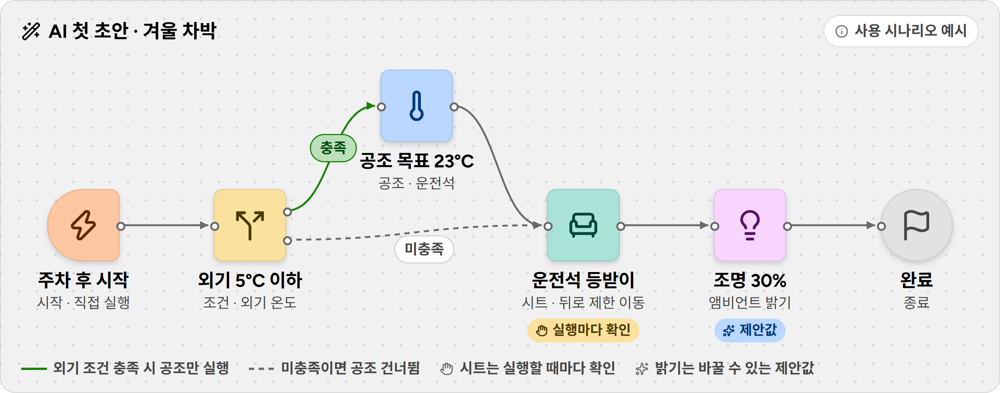
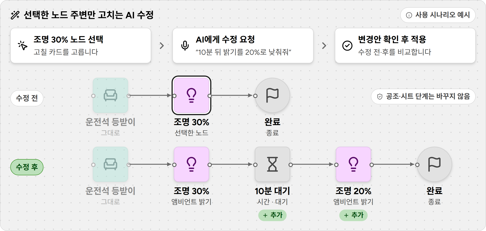
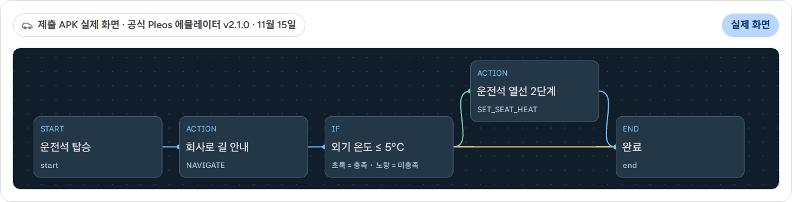
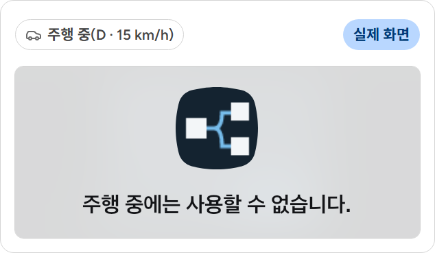
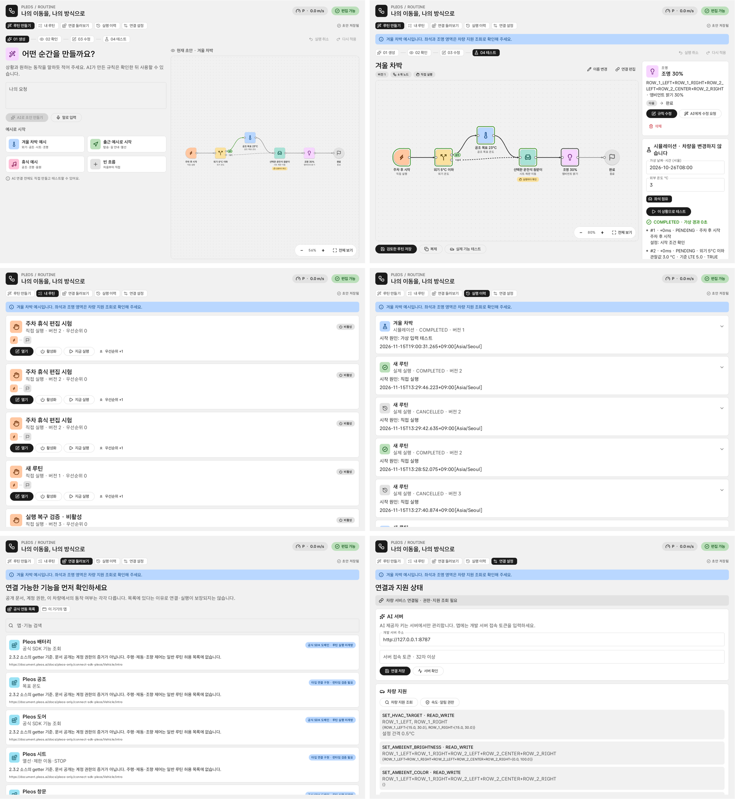
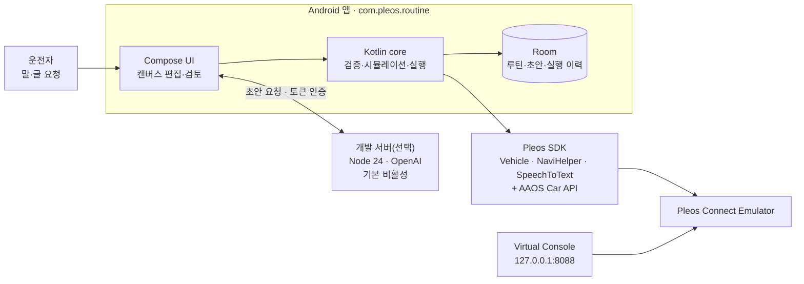

# Pleos AI Routine Builder

운전자가 원하는 상황을 말하면 AI가 눈에 보이는 차량용 루틴으로 만들고, 운전자가 화면에서 원하는 부분을 짚어 대화로 고친 뒤 저장할 수 있는 Pleos Connect 앱입니다.

팀 **forky** · 현대자동차그룹 차량용 앱 개발 공모전 출품작 · Pleos Connect(Android Automotive 14)

> **현재 상태:** 개발 중입니다. 공식 Pleos Connect 에뮬레이터에서 공조 목표 온도와 앰비언트 밝기·색상, 자체 음원은 실제 상태 반영까지 확인했습니다. 시트는 시험에서 이동·정지 명령이 에뮬레이터 시트 모델을 움직이고 멈추는 것까지 확인했지만, SDK가 바뀐 위치를 돌려주지 않아 앱 안에서 정지를 확인할 수 없습니다. 그래서 실제 루틴에서는 시트 명령을 보내지 않으며 **전체 기능 완성 상태는 아닙니다.** 실제 OpenAI 호출은 꺼 두었습니다. 자세한 내용은 [검증 현황](#검증-현황)에 있습니다.

## 시연 영상

[](https://youtu.be/hA8jhEtuvh0)

- 시연 영상: <https://youtu.be/hA8jhEtuvh0>
- 숏폼: <https://youtube.com/shorts/PHBOkS89bLM>

## 어떤 서비스인가요

> “겨울 차박 루틴을 만들고 싶어. 바깥이 5도 이하일 때만 공조를 23도로 맞춰줘. 매트리스를 놓게 의자를 젖혀두고, 조명은 살짝 어둡게 해줘.”

겨울 캠핑장에 도착한 운전자는 잠자리를 준비하려고 공조, 시트, 조명 메뉴를 차례로 엽니다. 다음 차박에도 같은 준비를 반복하지만, 날씨에 따라 공조만은 다르게 쓰고 싶습니다. Pleos AI Routine Builder는 이런 요청을 **조건과 동작이 보이는 흐름(루틴)** 으로 바꿔, 운전자가 직접 확인하고 고친 뒤 저장해 다시 쓰게 합니다.

**사용 흐름**

1. **말하거나 적기** — 요청 입력란에 글로 쓰거나 ‘말로 입력’을 누릅니다. 들은 문장은 입력란에만 채워지고, 운전자가 확인한 뒤에 보냅니다.
2. **AI 초안 확인** — AI가 시작 조건·분기·차량 동작을 노드 흐름으로 제안합니다. 좌석처럼 애매한 부분은 “어느 좌석의 등받이를 젖힐까요?”처럼 되묻습니다.
3. **짚어서 고치기** — 카드를 직접 편집하거나, 카드를 고른 뒤 AI에게 그 부분만 고쳐 달라고 요청합니다. 바뀌는 카드와 연결을 전후로 비교하고 ‘적용’합니다.
4. **가상으로 시험하기** — 외기 온도·기어 같은 가상 상태를 넣어 어느 동작이 실행될지 미리 봅니다. 이때 차량은 바뀌지 않습니다.
5. **저장하고 실행하기** — 이름을 확인해 저장합니다. 실제로 실행할 때 앱이 정차 상태와 권한, 차량이 지원하는 영역을 다시 확인합니다.



*그림 1. 겨울 차박 첫 초안(사용 시나리오 예시 도식). 외기 5°C 이하 조건은 공조에만 연결되고, 조명 30%는 제안값입니다.*



*그림 2. 조명 카드를 짚고 “10분 뒤 밝기를 20%로 낮춰줘”라고 요청한 수정 전후(사용 시나리오 예시 도식). 공조·시트 단계는 바뀌지 않습니다.*

## 주요 기능

| 기능 | 설명 |
|---|---|
| 말로 입력 | Pleos SpeechToText SDK의 차량 내 인식(ON_DEVICE, ko-KR). 들은 문장은 입력란에만 채우며 AI나 차량으로 자동 전송하지 않습니다. |
| AI 초안 생성·되묻기 | 개발 서버가 OpenAI 구조화 출력으로 `draft / needs_clarification / unsupported` 초안을 만듭니다. 지원 여부·권한·실행 승인은 앱이 결정합니다. |
| 흐름 캔버스 편집 | 시작 조건, 조건 분기, 대기·타이머, 반복, 병렬·합류 노드를 끌어 놓고 연결합니다. 실행 취소/다시 실행, 복제, 전체 보기를 지원합니다. |
| 선택 카드 AI 수정 | 고른 카드와 바로 뒤 단계만 바꾸는 제안인지 앱과 서버가 함께 검사하고, 변경 전후를 비교한 뒤 적용합니다. |
| 가상 시험 | 가상 날짜·외기 온도·기어 등으로 흐름을 시뮬레이션하고, 실행될 경로를 초록 테두리로 표시합니다. |
| 차량 제어 | 공조 목표 온도, 앰비언트 밝기·색상, 시트 앞뒤·등받이 제한 이동(실행마다 확인), 시트 열선, 내비 목적지 안내(NaviHelper). |
| 자체 음원·타이머 | 앱에 들어 있는 휴식 음원 재생과 타이머(1초~2시간). 남은 시간과 완료 알림을 표시합니다. |
| 실행 이력·설명 | 요청 전송, 응답 수신, 상태 반영 확인, 실패, 결과 불명을 단계별로 구분해 기록합니다. 당시 규칙 버전과 시작 원인도 남깁니다. |
| 주행 중 제한 | 주행으로 바뀌면 편집 창을 닫고 새 실행을 막으며, 작성 중인 초안은 보존합니다. |
| 연결 둘러보기 | 공식 출처가 붙은 연결 가능 기능 43항목. SDK 도메인·마켓 입점·직접 연결·추가 계약이 필요한 경우를 구분해 보여줍니다. |

## 앱 화면

아래 화면은 모두 공식 Pleos Connect Emulator v2.1.0(2560×1440)에서 이 앱을 실행해 캡처했습니다. 앱은 Pleos 홈의 오른쪽 영역에 표시됩니다.



*그림 3. 평일 출근 예시(제출 APK 실제 화면 발췌, 11월 15일). 회사 길 안내 다음에 외기 조건이 나오고, 추운 쪽에서만 운전석 열선으로 이어집니다.*



*그림 4. 주행 제한 안내(10월 28일 화면 발췌). P단에서 D단으로 바꾸고 가속하자 편집 창이 닫히고 초안은 보존됐습니다.*



*앱 주요 화면(밝은 테마, 11월 15일). 왼쪽 위부터 루틴 만들기, 겨울 차박 예시의 테스트 단계, 내 루틴, 실행 이력, 연결 둘러보기, 연결 설정입니다. 기기 설정에 따라 어두운 테마로 바뀝니다.*

## 동작 구조



**안전 원칙**

- AI는 초안만 만듭니다. 지원 여부, 권한, 실행 승인, SDK 호출은 앱이 결정합니다.
- 차량 제어는 차량이 알려준 영역·범위·단위를 확인한 뒤 타입이 있는 공식 API로 보냅니다.
- 시트가 든 루틴은 실행할 때마다 좌석·축·방향을 확인받습니다. 시트 이동·정지 교정 증거가 없는 지금은 시트 명령을 보내지 않고, 운전자가 동의한 그 실행에서만 시트 단계를 ‘미실행’으로 기록하고 나머지를 실행합니다.
- 요청 응답만으로 성공이라 하지 않습니다. 상태를 다시 읽어 반영을 확인하지 못하면 ‘결과 불명’으로 남깁니다.
- 주행 전환·취소·시간 초과 때 새 동작을 막고, 앱이 다시 시작돼도 과거 차량 명령을 자동으로 다시 보내지 않습니다.

**폴더 구조**

| 경로 | 내용 |
|---|---|
| `android/core/` | 순수 Kotlin 규칙 엔진: 루틴 모델, 검증, 시뮬레이션, 실행 한도 |
| `android/app/` | Compose UI, Room, 차량·음성·내비 연동, 실행 서비스 |
| `server/` | AI 초안·수정·실행 설명 API와 외부 연결(Node 24, TypeScript) |
| `contracts/` | 앱·서버가 함께 쓰는 JSON Schema, 연결 카탈로그, 예시 루틴 |
| `scripts/` | 로컬 도구 설치, 계약 생성, 문서 검사 |
| `design/` | Astryx 디자인 토큰·아이콘 생성과 기획서 그림 스크립트 |
| `evidence/` | 시험 로그, 화면, APK 해시 등 검증 증거 |
| `apk/` | 서명된 release APK |

## 테스트 환경

| 항목 | 값 |
|---|---|
| 에뮬레이터 | 공식 **Pleos Connect Emulator v2.1.0** (Android 14 / API 34, x86_64 시스템 이미지, Vehicle Service 2.3.22) |
| 화면 규격 | **2560 × 1440, 160dpi, 가로**. 앱은 Pleos 홈의 오른쪽 영역에 표시됩니다 |
| Android Emulator | 37.2.12, `-gpu host`, 현재 사용자 10 |
| 호스트 | Windows 11 x64 |
| SDK | Pleos Vehicle 2.3.2, NaviHelper 3.0.5, SpeechToText 3.3.1 · minSdk 28, targetSdk 35 |
| 차량 상태 입력 | Pleos Virtual Console (`adb forward tcp:8088 tcp:8088` 후 `http://127.0.0.1:8088/`) |
| AI 서버 | 선택. 없어도 예시·직접 편집·가상 시험·저장·실행이 됩니다. AI 초안 만들기만 서버가 필요합니다 |

## 실행 방법

이미 빌드된 APK로 바로 실행하는 방법입니다. 소스 빌드는 [소스에서 빌드하기](#소스에서-빌드하기)를 보세요.

### 1. Pleos Connect Emulator 준비

[공식 설치 안내](https://document.pleos.ai/docs/connect/guide/getting-started/application-development/setup-connect-sdk-emulator)를 따릅니다.

1. Android Studio의 **SDK Manager → SDK Update Sites**에 아래 사이트를 추가합니다(Windows/Linux용 주소입니다).
   - Name: `Pleos Connect System Image`
   - URL: `https://nexus-playground.pleos.ai/repository/raw-releases/connect-avd/2.x/crp-sys-img.xml`
2. **SDK Platforms → Show Package Details → Android API 34**에서 Pleos Connect 시스템 이미지를 설치합니다.
3. **Device Manager**에서 Form Factor **Automotive → Pleos Connect v2.1.0**, API 34 이미지를 골라 AVD를 만듭니다. 고급 설정에서 부팅을 **Cold**, RAM을 **4 GB**로 둡니다.
4. AVD를 시작하고, Pleos 홈 화면 초기화가 끝날 때까지 기다립니다.

### 2. APK 설치

`adb`는 Android SDK의 `platform-tools` 폴더에 있습니다(기본 위치 `%LOCALAPPDATA%\Android\Sdk\platform-tools`). 저장소 루트의 PowerShell에서 실행합니다.

```powershell
adb devices                                  # 예: emulator-5554  device
$Device = 'emulator-5554'                    # 위 목록에 보이는 이름으로 바꾸세요
adb -s $Device shell am get-current-user     # 공식 AVD에서는 10이었습니다
adb -s $Device install --user 10 apk\forky_forky_release.apk
```

이전에 다른 서명 키로 만든 APK가 설치돼 있으면 먼저 지우고 설치하세요.

### 3. Virtual Console 연결

가상 차량의 기어·공조·조명 상태를 바꾸고 확인하려면 [Virtual Console](https://document.pleos.ai/docs/connect/guide/getting-started/application-development/use-vehicle-emulator)을 엽니다.

```powershell
adb -s $Device forward tcp:8088 tcp:8088
Start-Process 'http://127.0.0.1:8088/'
```

> 이 프로젝트의 시험에서 관찰한 점(공식 문서에 적힌 내용은 아님): Console 탭이 화면에 보이지 않는 동안에는 공조·조명 쓰기 반영이 늦어져, 앱이 그 단계를 ‘결과 불명’으로 기록했습니다. 차량 동작을 시험할 때는 Console 탭을 띄워 두세요.

### 4. 앱 사용

1. 에뮬레이터 앱 목록에서 **Pleos AI 루틴**을 엽니다.
2. **연결 설정** 탭에서 **속도·알림 권한**을 요청하고, **차량 지원 조회**로 공조·조명 영역이 보이는지 확인합니다.
3. **루틴 만들기** 탭의 예시(겨울 차박, 출근, 휴식)를 열고 **04 테스트**에서 가상 상태로 시험합니다.
4. 이름을 확인해 저장한 뒤 **내 루틴**에서 ‘지금 실행’하면 실제 차량(에뮬레이터) 동작이 실행되고, **실행 이력**에서 단계별 결과를 볼 수 있습니다. 시트 단계가 있으면 ‘시트 단계 제외 실행 확인’ 창이 뜹니다.

AI로 초안을 만들려면 아래 [AI 서버 연결](#ai-서버-연결-선택)이 필요합니다.

## 소스에서 빌드하기

필요한 도구: JDK 17, Node 24, Python 3, Android SDK(Platform 35 포함). Pleos SDK 저장소(`https://nexus-playground.pleos.ai/repository/maven-releases/`)는 [settings.gradle.kts](android/settings.gradle.kts)에 이미 들어 있고 인증이 필요 없습니다.

검증에 쓴 버전은 Corretto 17.0.21.0.11, Node 24.22.1, Gradle 8.14.6입니다. 아래 스크립트는 전역 설정을 바꾸지 않고 공식 배포본을 SHA-256으로 확인해 Git 제외 폴더 `.tools/`에 설치합니다.

```powershell
python scripts/bootstrap_node.py
python scripts/bootstrap_java.py
$env:JAVA_HOME = "$PWD\.tools\corretto-17.0.21.0.11"
$env:Path = "$PWD\.tools\node-v24.22.1-win-x64;" + $env:Path
$env:GRADLE_USER_HOME = "$PWD\.tools\gradle-home"
python scripts/generate_contracts.py
```

Android SDK 경로는 `ANDROID_HOME` 환경 변수나 `android/local.properties`의 `sdk.dir`로 지정합니다(Android Studio로 `android/` 폴더를 열면 `local.properties`가 만들어집니다).

```powershell
& .\android\gradlew.bat -p android :core:test :app:testDebugUnitTest :app:assembleDebug :app:lintDebug --max-workers=2 --no-daemon '-Pkotlin.compiler.execution.strategy=in-process'
adb -s $Device install -r --user 10 android\app\build\outputs\apk\debug\app-debug.apk
```

debug APK와 release APK는 서명이 달라 서로 덮어 설치되지 않습니다. release 서명 키는 저장소에 없습니다. 직접 만든 키로 `:app:assembleRelease` 결과를 `zipalign`·`apksigner`로 서명하는 절차는 [APK 검증 기록](09_SUBMISSION_CHECKLIST.md#apk-검증-기록)에 있습니다.

## AI 서버 연결 (선택)

`server/`는 AI 초안 생성·선택 카드 수정·실행 설명 API를 제공하는 Node 24 서버입니다. AI 공급자 키는 서버에만 두고 APK에는 넣지 않습니다.

```powershell
cd server
npm ci
npm test
npm run build
Copy-Item .env.example .env
node -e "console.log(require('crypto').randomBytes(32).toString('base64url'))"   # 이 값을 .env의 SERVER_AUTH_TOKEN에 넣으세요
npm start
```

- 기본값은 `AI_ENABLED=false`, 일·월 예산 0, `CONNECTORS_ENABLED=false`입니다. 이 상태에서 AI 요청은 공급자 호출 전에 거절되고 앱은 안내 문구를 보여줍니다.
- 실제 AI를 쓰려면 `.env`에 `OPENAI_API_KEY`, `AI_ENABLED=true`, 0보다 큰 `AI_DAILY_BUDGET_USD`·`AI_MONTHLY_BUDGET_USD`를 모두 설정해야 합니다. 이 프로젝트는 아직 실제 OpenAI 호출로 검증하지 않았습니다.
- 에뮬레이터에서 PC의 서버로 연결하려면 `adb -s $Device reverse tcp:8787 tcp:8787`을 실행한 뒤, 앱의 **연결 설정 → AI 서버**에 주소와 토큰을 넣고 **연결 저장 → 서버 확인**을 누릅니다.
- debug APK는 `http://127.0.0.1:8787`(기본값)을 쓸 수 있습니다. release APK는 HTTPS 주소만 받습니다.

API 경로, 예산 장부, 외부 연결(Google Calendar, Home Assistant, 카카오, what3words) 설정은 [서버 안내](server/README.md)를 보세요.

## 시험

| 범위 | 명령 | 최근 결과 |
|---|---|---|
| core·app 단위시험, lint | 위 Gradle 명령 | core 108, app 106 통과, lint 오류 0 (0.1.1) |
| 서버 | `server/`에서 `npm test` | 61 통과 (11월 15일) |
| 에뮬레이터 계측 | `adb shell am instrument --user 10 ...` | 30건 통과 (11월 15일, 일부는 명시 인자 필요) |

계측 시험의 인자, Virtual Console·로컬 fixture 준비 조건, 프로세스 복구 시험은 [Windows 인수인계](12_WINDOWS_HANDOFF.md)와 [W30 검증](evidence/W30/verification.md)에 있습니다.

## 검증 현황

| 항목 | 상태 | 근거 |
|---|---|---|
| 공조 목표 온도, 앰비언트 밝기·색상 | release 0.1.1 APK로 휴식 예시 10회(직접 실행 5, 기어 P 조건 자동 실행 5) 모두 Console 값 변경과 앱의 상태 반영 확인 | [10회 기록](evidence/release-0.1.1-2026-11-16/README.md) |
| 자체 음원 | 위 10회 모두 재생 확인, 중지 후 정리 확인 | 같은 기록 |
| release 필수 흐름 10회(T36) | **미통과.** 위 10회는 실행 가능한 항목만 통과했고, 기준에 든 실제 AI 초안과 시트 이동·STOP은 매 회 실행하지 않았습니다 | 같은 기록 |
| 30분 타이머 완료 | 10월 28일 APK로 1,800초 뒤 완료 기록 확인. 위 10회는 타이머 시작 후 중지했습니다 | [W14 측정값](evidence/W14/long-timer-persisted-result.txt) |
| 시트 앞뒤·등받이 이동과 STOP | **미통과.** 시험 프로브의 MOVE/STOP이 두 축·두 방향 모두 에뮬레이터 시트 모델을 움직이고 멈췄습니다. 하지만 SDK 위치 조회가 28회 모두 0이라 앱 안의 정지 확인을 통과할 수 없어, 루틴 실행에서는 시트 명령을 보내지 않고 동의한 실행에서만 ‘미실행’으로 기록합니다 | [시트 검증 기록](evidence/seat-move-2026-11-16/README.md) |
| 말로 입력 | 서비스 연결·요청·준비 신호·중지 확인. 에뮬레이터를 소리 없이 띄워 실제 목소리 인식은 미확인. 새로 만든 AVD에서 `ON_DEVICE_ENGINE_ERROR`가 난 적이 있고(원인 미확정), 이때 앱은 글 입력을 안내합니다 | [W30 검증](evidence/W30/verification.md) |
| AI 초안·수정·설명 | 로컬 모의 응답으로 시험. 실제 OpenAI 호출과 한국어 평가는 미실행 | [서버 안내](server/README.md) |
| Gleo 음성 호출 | 진입점 코드만 있습니다. 공모전 공지상 참가팀은 Gleo App Schema 승인을 신청할 수 없습니다 | [공식 출처](11_SOURCES.md) |
| 주행 중 제한 | D단 전환·가속 시 편집 창 닫힘, 새 실행 없음, 초안 보존 | [주행 입력 검증](evidence/W04/console-driving-verification.md) |

공조·조명·시트를 모두 검증해야 전체 완료로 봅니다. 시트가 남아 있으므로 현재는 **전체 구현 완료가 아닙니다.** 남은 일과 요구사항별 추적은 [구현 TODO](13_IMPLEMENTATION_TODO.md)를 보세요.

## APK 위치와 버전

| 구분 | 내용 |
|---|---|
| 위치 | [`apk/forky_forky_release.apk`](apk/forky_forky_release.apk) |
| 현재 버전 | **0.1.1** (versionCode 2), 71,252,801바이트, 앱 소스 커밋 `e54640e` |
| SHA-256 | `8c924c9d47bad7172db343949dba08c802492d3ae4ef705e1149ed54e8eb5214` |
| 공모전 심사 커밋 | [`314b9e2ba432cfb26c0a73341ebd0f2c91e0eea5`](https://github.com/1223v/pleos-automation/tree/314b9e2ba432cfb26c0a73341ebd0f2c91e0eea5) — 이 커밋의 APK는 0.1.0, SHA-256 `0a60626cdf1ea2c6f547b2bd5dab5ea5fbcaf04b759a7ac47252300247bca2ee` |

0.1.1은 예시 루틴의 차량 단계가 차량이 알려준 영역을 쓰도록 고친 판입니다. 0.1.0과 같은 서명 키라 그 위에 덮어 설치됩니다. 서명·설치 기록은 [제출 체크리스트](09_SUBMISSION_CHECKLIST.md#apk-검증-기록)에 있습니다.

## 문서

| 문서 | 내용 |
|---|---|
| [AGENTS.md](AGENTS.md) | 작업 규칙과 기능·안전 계약 |
| [01_FACT_CHECK.md](01_FACT_CHECK.md) | 사실 검증 |
| [02_COMPETITION_GUIDE.md](02_COMPETITION_GUIDE.md) | 공모전 안내 정리 |
| [03_PRODUCT_PRD.md](03_PRODUCT_PRD.md) | 제품 요구사항(R01~R20) |
| [04_TECHNICAL_ARCHITECTURE.md](04_TECHNICAL_ARCHITECTURE.md) | 기술 설계와 실행 계약 |
| [05_CAPABILITY_MATRIX.md](05_CAPABILITY_MATRIX.md) | 기능별 공식 API와 실행 조건 |
| [06_DEVELOPMENT_ROADMAP.md](06_DEVELOPMENT_ROADMAP.md) | 개발 일정 |
| [07_VALIDATION_AND_DEMO.md](07_VALIDATION_AND_DEMO.md) | 검증·시연 계획과 증거 양식 |
| [08_APPLICATION_DRAFT.md](08_APPLICATION_DRAFT.md) | 10월 기획서 초안(과거 기록) |
| [09_SUBMISSION_CHECKLIST.md](09_SUBMISSION_CHECKLIST.md) | 제출 체크리스트와 APK 서명 기록 |
| [10_OPEN_QUESTIONS_AND_RISKS.md](10_OPEN_QUESTIONS_AND_RISKS.md) | 남은 질문과 위험 |
| [11_SOURCES.md](11_SOURCES.md) | 공식 출처 색인 |
| [12_WINDOWS_HANDOFF.md](12_WINDOWS_HANDOFF.md) | Windows 환경과 계측 시험 절차 |
| [13_IMPLEMENTATION_TODO.md](13_IMPLEMENTATION_TODO.md) | 구현 TODO와 요구사항 추적 |
| [security_best_practices_report.md](security_best_practices_report.md) | 보안 점검 보고서 |
| [design/ASTRYX_NOTES.md](design/ASTRYX_NOTES.md) | 디자인 시스템 적용 기록 |

## 출처와 라이선스

- 디자인 토큰: Meta [Astryx](https://github.com/meta/astryx) `@astryxdesign/theme-neutral` 0.7.16 (MIT). 앱 테마와 기획서 그림에 썼습니다.
- 아이콘: [Lucide](https://lucide.dev) (ISC). 앱 아이콘 리소스와 기획서 그림에 썼습니다.
- 글꼴(기획서 그림): Figtree, Noto Sans KR (OFL).
- 휴식 음원: 이 프로젝트가 사인파 합성으로 만든 음원입니다. [음원 출처](android/app/src/main/assets/AUDIO_LICENSE.md)
- 이 저장소 자체의 라이선스 파일은 아직 없습니다.
