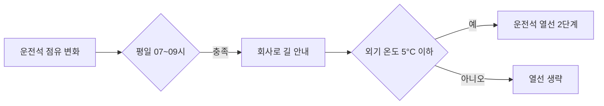

<!-- Audit snapshot: retrieved 2026-10-30 KST from chat 01a17324-de53-7882-a8d5-f60adc59c057, turn 01a17ab9-b22e-73d0-9248-561439bb56b0. Original approved plan text follows; unchanged. -->

# Pleos AI Routine Builder 구현 계획

## 1. 목표와 확정 범위

**Gleo AI로 루틴을 만들고, 사용자가 워크플로우를 확인·수정·시험한 뒤 활성화하는 Android Automotive 앱**을 만든다. 기존 Moment Routine 기획을 확장하며, 현재 저장소에는 문서만 있고 앱·서버·APK는 아직 없다.

- **첫 버전 포함:** 자연어 생성·부분 수정·호출, n8n 형태의 노드 편집, 조건 분기, 대기, 반복, 병렬 실행, 시뮬레이션, 실제 실행 이력.
- **트리거:** 수동·Gleo 호출, 시간, 검증된 차량 상태 변화와 좌석 점유 변화. 재시작 후에는 활성 루틴의 감시를 복구하되, 지나간 이벤트와 중단된 물리 명령은 재실행하지 않는다.
- **필수 차량 기능 유지:** 공조 목표 온도, 앰비언트 밝기·색상, 시트 앞뒤·등받이 제한 이동과 STOP, 타이머·자체 음원. 출근 예제를 위해 외기 온도 조건·시트 열선·기본 내비게이션을 추가한다.
- **주행 정책:** 복잡한 생성·편집은 보류하고 초안을 저장한다. 주행 중 실행은 검증된 내비·미디어 동작으로 제한하며, 차량 쓰기는 주차·정차 조건을 적용한다.
- **공개 API가 확인되지 않은 운전자 신원 식별은 제외한다.** 좌석 점유를 운전자 인증으로 표시하지 않는다.
- **OpenAI 실제 호출은 키와 예산 설정 전까지 비활성화한다.** 수동 편집·시뮬레이션·엔진·연동 코드와 모의 시험은 먼저 개발한다.
- 일정은 기존 11월 13일보다 기능 완성과 검증을 우선한다.

## 2. 연결 기능 목록과 구현 기준

‘연결 가능한 것 전부’의 조사 범위는 **Pleos 공개 SDK 전체, 공식 발표에 등장한 App Market 서비스, 기획서의 내비·미디어·일정·스마트홈 분야**로 잡는다. 문서상 API 존재, 계정 연결, 대상 환경 검증을 각각 표시한다.

### 차량·플랫폼 기능

| 분류 | 목록에 포함할 기능 | 첫 버전 처리 |
|---|---|---|
| 공조·실내 조명 | 목표 온도, 공조 상태, 앰비언트 밝기·색상 | 필수 구현·에뮬레이터 검증 |
| 시트 | 점유 상태, 열선, 위치 조회, 앞뒤·등받이 이동과 STOP | 필수 구현. 이동은 매 실행 확인 |
| 차량 조건 | 기어, 실제 속도, 외기 온도, 공개된 상태·경고 정보 | 지원·권한·값의 유효성을 확인한 조건만 제공 |
| 기본 내비 | 목적지 설정·확인·취소, 경유지, 경로 옵션 | NaviHelper 연동 |
| 음원·타이머 | 자체 음원 재생·중지, 타이머, 조용한 대기 | 로컬 실행 |
| 추가 SDK 영역 | 도어·창문·와이퍼·미러·핸들·배터리·연료·주행거리·타이어·하이패스 등 | 공개 기능을 카탈로그에 기록하고 구현·검증 상태 표시 |

Vehicle SDK는 19개 도메인을 공개하지만, 문서에 제어 함수가 있다는 사실만으로 사용자 계정이나 대상 차량에서 사용할 수 있다고 판단하지 않는다. 주행·제동·조향 제어는 일반 자동화 액션으로 제공하지 않는다. [Vehicle SDK](https://document.pleos.ai/docs/pleos-only/connect-sdk-pleos/Vehicle/intro)

기본 내비는 `requestRoute`로 요청하고 이벤트와 목적지 조회로 결과를 확인한다. 함수 호출 성공을 길 안내 완료로 표시하지 않는다. [NaviHelper](https://document.pleos.ai/docs/pleos-only/connect-sdk-pleos/NaviHelper/destinations)

### 외부 앱·서비스

| 서비스·연결 방식 | 제공하려는 동작 | 계획에 반영할 상태 |
|---|---|---|
| Android 표준 미디어 연결 | 재생·일시정지·다음 곡·지원되는 콘텐츠 탐색 | 공통 어댑터 구현. 앱별 연결 허용과 명령 지원 검증 |
| Google Calendar | 오늘·다음 일정 조회 | 읽기 전용 커넥터 구현, OAuth 연결 후 활성화 |
| Home Assistant | 상태 조회, 사용자가 선택한 조명·공조·장면 실행 | 커넥터 구현, 서버 연결과 대상 선택 후 활성화 |
| 카카오 로컬 | 주소·장소를 목적지 좌표로 변환 | 검색 어댑터 구현, 키·이용 조건 충족 후 활성화 |
| what3words | 세 단어 주소와 좌표 변환 | 어댑터 구현, 키·요금 조건 충족 전 비활성 |
| 카카오내비 | 목적지·경유지를 전달해 길 안내 요청 | 공식 Android 연동을 구현하되 Pleos용 앱 호환성 별도 검증 |
| 설치된 앱 열기 | 사용자가 선택한 앱 실행 | 공개 Intent로 확인된 앱만 제공. 내부 기능 제어와 구분 |
| SmartThings | 기기 상태 조회·명령 | 카탈로그에 포함하되 신규 등록 경로 확보 전 연결 보류 |
| Spotify | 재생 제어 API 존재 | 음성 제어 정책상 별도 승인 전 루틴 커넥터 비활성 |
| Radioline·Make My Day | 오디오 카탈로그·경로 계획 | 파트너 접근이 필요한 후보로 기록 |
| 나머지 App Market 앱 | 앱 열기 또는 표준 미디어 연결 가능성 | 공개 제어 계약을 확인한 동작만 제공 |

근거: [Android 미디어 연결](https://developer.android.com/media/media3/session/connect-to-media-app), [Google Calendar](https://developers.google.com/workspace/calendar/api/v3/reference/events/list), [Home Assistant](https://contributors.home-assistant.io/core/internals/rest-api/), [카카오 로컬](https://developers.kakao.com/docs/ko/local/dev-guide), [what3words](https://developer.what3words.com/public-api/docs), [카카오내비](https://developers.kakao.com/docs/ko/kakaonavi/android).

SmartThings 신규 API Access App 등록은 현재 준비 중으로 안내돼 있다. Spotify는 별도 승인 없는 음성 제어 애플리케이션을 금지한다. 두 서비스를 즉시 연결 가능한 것으로 표시하지 않는다. [SmartThings 등록 안내](https://developer.smartthings.com/docs/service-integrations/app-setup), [Spotify 정책](https://developer.spotify.com/policy). Radioline과 Make My Day는 API 접근 요청 절차가 있다. [Radioline](https://business.radioline.co/), [Make My Day](https://www.makemydayapp.com/api.php).

공식 국내 발표에서 이름을 확인한 **네이버 오토·네이버 지도·YouTube·Spotify·SBS고릴라·essential;·지니·카카오내비·what3words·Make My Day·멜론·Radioline·RaiDIO Auto·Pickle**을 조사 목록에 넣는다. 발표된 총 18종의 완전한 명단이나 모든 앱의 외부 제어 가능성이 확인된 것은 아니므로, 대상 환경의 실제 앱 목록과 대조한다. [초기 서비스 발표](https://www.hyundaimotorgroup.com/ko/news/hyundai-motor-group-redefines-in-vehicle-experience-with-pleos-connect-next-generation-infotainment-system), [추가 앱 발표](https://www.hyundaimotorgroup.com/ko/news/42dot-pleos-connect-app-market-new-apps).

## 3. 화면·데이터·실행 설계

### 생성 → 확인 → 수정 → 테스트

- **생성:** 음성·텍스트 입력, 필요한 항목만 추가 질문, 추천값에 ‘AI 제안’ 표시. 불완전한 내용도 초안으로 저장한다.
- **확인:** 시작 조건, 전체 실행 조건, 특정 동작에만 적용되는 조건을 구분한다. 저장과 활성화를 분리한다.
- **수정:** 규칙 카드와 노드 그래프가 같은 데이터를 편집한다. 노드 추가·연결·이동·삭제, 확대·축소, 직접 값 변경, 자연어 부분 수정, 변경 비교·Undo·복제를 제공한다.
- **테스트:** 가상 시간·온도·탑승 상태로 실행 경로를 보여준다. 실제 차량 시험은 별도 버튼과 확인 절차를 사용한다.
- **내 루틴·이력:** 켜기·끄기, 버전, 실행 결과, 미실행 이유와 해당 조건 편집을 연결한다.

화면은 차량 앱 영역에 배치한다. 넓은 화면은 기능 목록·플로우·AI/속성 패널로 구성하고, 좁은 분할 화면은 패널을 전환한다. 기본 색상은 짙은 남색 `#142330`, 패널 `#233747`, 본문 `#F3F6F8`, 선택 `#76BCEB`, 주의 `#EBC477`, 오류 `#F08D87`로 정한다. 한국어 시스템 글꼴과 큰 터치 영역을 사용하며, 실행 경로와 변경된 노드에만 시각적 강조를 준다.

출근 예제의 의미는 다음과 같이 고정한다.

온도 조건 때문에 길 안내까지 생략되는 오류를 방지한다. 목적지가 없으면 등록을 요청하고, ‘2단계’는 대상 차량의 지원 범위와 실제 매핑을 확인한다.

### 핵심 인터페이스

| 인터페이스 | 책임 |
|---|---|
| `WorkflowDefinition` | 버전이 있는 노드·연결·조건·동작 정의. 화면 좌표는 실행 의미와 분리 |
| `WorkflowPatch` | 기준 버전과 변경 대상만 지정하는 AI 수정안. 적용 전 비교·검증 |
| `CapabilityDescriptor` | 기능 ID, 입력·출력 타입, 권한·영역·단위, 연결 조건, 공식 출처, 검증 상태 |
| `ExecutionContext` | 실제 상태 또는 시뮬레이션 상태, 관찰 시각·유효성·출처 |
| `ExecutionJournal` | 실행·노드·분기·반복별 요청, 응답, 상태 확인, 실패·결과 불명 |
| 생성·설명 서버 API | `POST /v1/routine-drafts`, `POST /v1/run-explanations`. 차량 실행 권한 없음 |

Android는 Kotlin·Compose, Coroutines, Room, Kotlin Serialization, Media3를 사용한다. 그래프는 Compose로 구현한다. 서버는 Windows의 Node.js 24·TypeScript와 공식 OpenAI SDK를 사용하며, 외부 배포는 이번 개발의 기본 전제로 삼지 않는다. 의존성은 공식 호환성을 확인하고 버전·잠금 파일로 고정한다.

### 실행 계약

- 노드는 시작·조건·동작·대기·타이머·반복·병렬/합류로 제한한다. 임의 코드 실행과 무제한 순환 연결은 허용하지 않는다.
- 제품 기본 상한은 64개 노드, 병렬 4개 분기, 반복 20회, 실행 2시간이다. 실제 차량의 안전 한도와 구분한다.
- 첫 버전은 동시에 한 루틴을 실행하고 루틴 내부 병렬을 지원한다. 동일 자원을 쓰는 병렬 분기는 검증 오류로 표시한다.
- 다른 루틴과 충돌하면 사용자가 정한 우선순위를 적용한다. 미해결 충돌은 보류하며 늦게 물리 명령을 실행하는 자동 대기열은 만들지 않는다.
- `WAIT`는 조용히 기다리고, 타이머는 표시·완료 알림을 가진다. 둘 다 자신의 분기만 대기시킨다.
- 화면을 다른 앱으로 전환해도 실행 서비스는 유지한다. Android의 적절한 foreground service 유형과 중지 알림을 적용하고, 실제 Pleos 환경에서 지속 동작을 검증한다. [Android 서비스 유형](https://developer.android.com/develop/background-work/services/fgs/service-types)
- 주행 UI 제한은 `CarUxRestrictions`를 사용한다. 차량 쓰기 직전에는 별도로 실제 기어·속도·상태의 유효성을 검사한다. [Pleos 주행 규제](https://document.pleos.ai/docs/pleos-only/vehicle-app-developer-guide/driving-restriction-development-guide)
- 시트 이동은 실행마다 확인하고 한 축씩 수행한다. 반복으로 다시 이동할 때도 새 확인이 필요하다. 취소·주행 전환·시간 초과 시 STOP을 우선 처리한다.
- 부분 실패 시 물리 상태를 자동 원복하지 않는다. 재시작 시 중단된 실행은 중단·결과 불명으로 복구한다.

### AI와 Gleo

Gleo에는 `CREATE_ROUTINE`, `EDIT_ROUTINE`, `CONTROL_ROUTINE` 세 진입점을 둔다. 생성·수정·실행 요청을 앱의 검토·확인 흐름으로 연결하고, 긴 작업은 접수 결과와 최종 완료를 구분한다. 외부 Intent 수신만으로 물리 실행 승인을 부여하지 않는다. 스키마 등록과 실제 호출 형식은 대상 에뮬레이터에서 검증한다. [Gleo 스키마](https://document.pleos.ai/docs/pleos-only/app-integration-guide/guide/app-capability), [콜백 계약](https://document.pleos.ai/docs/pleos-only/app-integration-guide/guide/action_callback)

OpenAI는 Responses API와 Structured Outputs를 사용한다. 초기 모델 설정은 `gpt-6.1-sol`, reasoning `low`로 두고 한국어 평가 결과로 조정한다. 모델은 초안·수정안·설명만 생성하며 로컬 검증기를 통과해야 한다. 키·예산·명시적 호출 활성화 설정이 모두 갖춰지기 전에는 네트워크 호출을 차단한다. [모델 문서](https://developers.openai.com/api/docs/models/gpt-6.1-sol), [구조화 출력](https://developers.openai.com/api/docs/guides/structured-outputs?api-mode=responses)

## 4. 구현 TODO와 진행 순서

기존 [구현 TODO](C:/pleos-automation/13_IMPLEMENTATION_TODO.md)를 확장한다. R01~R13과 W01~W22를 유지하면서 현재 요구와 충돌하는 내용을 수정한다.

| 단계 | 작업 | 완료 조건 |
|---|---|---|
| 1. 문서 정합성 | 현재 Git 상태, 확장 범위, 백그라운드·음성 정책, 일정, 출처 갱신 | 요구사항·작업·시험 연결과 상충 문구 해소 |
| 2. 환경·가능성 검증 | 공식 Pleos AVD, 샘플, 차량 제어·STOP, 내비·Gleo·백그라운드 실험 | API 존재와 실제 실행 증거 분리 |
| 3. 공통 모델·엔진 | 그래프 검증, 저장·버전, 트리거, 실행·취소, 시뮬레이터 | UI 없이도 결정적인 실행 결과 재현 |
| 4. 차량 UX | 네 단계 화면, 플로우 편집, AI 수정 비교, 충돌·이력 | 수동으로 전체 루틴 작성·시험·저장 가능 |
| 5. AI·외부 연결 | 호출 차단이 기본인 AI 서버, Gleo 진입점, 카탈로그·커넥터 | 미연결·미지원·검증 완료 상태가 정확히 표시 |
| 6. 통합·release | 실제 연결 시험, 오류 수정, 반복 검증, APK·증거 정리 | 필수 요구사항별 검증 결과와 재현 자료 확보 |

추가 요구사항은 시각 편집, 제어 흐름, Gleo, 시뮬레이션·설명, 외부 연결, 백그라운드·감시 복구, 외기 온도·열선·내비로 나누고 W23 이후 작업과 T39 이후 시험을 연결한다. 공식 근거는 [출처 색인](C:/pleos-automation/11_SOURCES.md)에 확인일·버전·범위를 기록한다.

권한이나 계정 때문에 일부 실제 시험이 막혀도 모델·UI·엔진·모의 시험은 계속한다. 필수 차량 기능을 임의로 선택 기능으로 낮추지 않는다.

## 5. 검증과 완료 기준

[기존 검증 계획](C:/pleos-automation/07_VALIDATION_AND_DEMO.md)을 다음 사례로 확장한다.

- **의미 검증:** 외기 3°C에서는 내비·열선, 12°C에서는 내비만 실행. 온도 미확인 상태를 정상적인 조건 불충족으로 숨기지 않는다.
- **편집 일치:** 자연어 수정과 직접 편집의 실행 결과가 같고, 시간·온도 변경이 다른 노드를 바꾸지 않는다. Undo·복제·버전 충돌도 검증한다.
- **흐름 검증:** IF의 선택 분기, 반복 상한, 병렬 합류, 타이머, 취소, 자원 충돌, 잘못된 연결을 시험한다.
- **자동 실행:** 초기부터 참인 상태, 중복 이벤트, 좌석 상태 초기화 오류, 재부팅, 놓친 시간 이벤트가 의도하지 않은 실행을 만들지 않는다.
- **수명·안전:** 앱 전환, 주행 전환, 권한 철회, 연결 단절, 프로세스 종료, STOP 실패와 늦은 콜백을 시험한다.
- **연결 검증:** OAuth 만료, API 오류·요금 제한, 앱 미설치, 미디어 연결 거부, 지원하지 않는 명령을 각각 표시한다.
- **AI 검증:** 키·예산 설정 전 호출 0건. 활성화 이후 한국어 30개 이상에서 지원 요청 의미 일치율 90% 이상, 승인되지 않은 실행 0건을 확인한다.
- **최종 검증:** 동일 release APK로 전체 흐름 10회, 실제 30분 타이머, 공조·조명 상태 반영, 두 시트 축 이동·STOP 증거를 확보한다.

**코드 구현 완료, 모의 시험 통과, 공식 에뮬레이터 검증, 실제 AI 검증을 별도 상태로 관리한다.** OpenAI 호출 보류나 필수 차량 제어 미검증이 남아 있으면 해당 항목과 전체 제품의 최종 완료를 구분해 보고한다.

